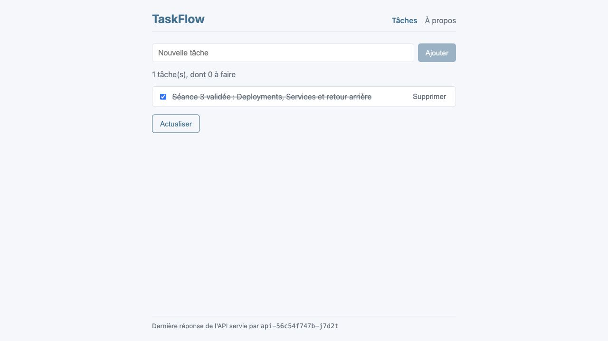

# Point de contrôle — séance 3 : Deployments et Services

Contrôle réalisé le **7 octobre 2026**, sur le cluster local **`k3d-seance3`** (k3s `v1.32.5+k3s1`, Linux ARM64), depuis macOS/Docker Desktop. Le troisième PDF est intitulé « Séance 5 » dans le cours ; il correspond ici à la troisième séance fournie.

**État final : une base PostgreSQL 17, deux API 1.0.0 et deux fronts 1.0.0 sont disponibles.** Les quatre fichiers de [k8s/app/](../k8s/app/) suffisent à créer les ressources de l'application. Le [guide détaillé](seance-3-services.md) décrit les six étapes ; le [README](../README.md#réponses-et-justifications--troisième-sujet-deployments-et-services) centralise les réponses et justifications.

## 1. Sortie Kubernetes réelle

Commande exécutée avec le kubeconfig privé du poste :

```sh
export KUBECONFIG="$HOME/.kube/taskflow-seance3.yaml"
kubectl --context k3d-seance3 get deployments,services -n taskflow
```

Sortie après réinstallation du namespace et création de la tâche finale :

```text
NAME                    READY   UP-TO-DATE   AVAILABLE   AGE
deployment.apps/api     2/2     2            2           79s
deployment.apps/db      1/1     1            1           79s
deployment.apps/front   2/2     2            2           79s

NAME            TYPE           CLUSTER-IP      EXTERNAL-IP   PORT(S)           AGE
service/api     ClusterIP      10.43.144.42    <none>        3000/TCP          79s
service/db      ClusterIP      10.43.40.157    <none>        5432/TCP          79s
service/front   LoadBalancer   10.43.163.169   172.22.0.3    32000:32726/TCP   79s
```

L'IP externe `172.22.0.3` est celle du nœud Docker. Depuis ce Mac, le port publié est **32002 → 32000** : ouvrir [TaskFlow](http://127.0.0.1:32002). Sur la VM du sujet, l'adresse prévue est `http://<IP-de-la-VM>:32000`. Le port `32726` est un NodePort attribué automatiquement, pas l'adresse utilisée par le navigateur local.

La sortie [complète](verification/services/final-deployments-services.txt), les [Pods](verification/services/final-pods.txt), les [EndpointSlices](verification/services/final-endpointslices.json) et les [Pods ServiceLB](verification/services/final-loadbalancer-pods.txt) sont conservés. Ces adresses reflètent cette exécution ; elles peuvent changer si le namespace est recréé.

## 2. Capture du navigateur

La tâche « Séance 3 validée : Deployments, Services et retour arrière » a été créée dans le navigateur, cochée, puis relue après rechargement. Elle reste terminée. Le pied de page affiche l'API qui a servi la réponse : **`api-56c54f747b-j7d2t`**.



La [réponse JSON finale](verification/services/browser-final-tasks.json) confirme cet état. La [capture initiale](verification/services/browser-initial.jpg), prise avant les expériences destructives de la base, reste une preuve historique distincte.

## 3. Expériences vérifiées

| Contrôle | Résultat observé |
| --- | --- |
| Connexion PostgreSQL par le Service db | `pg_isready` accepte la connexion. |
| Deux API derrière le Service | 50 requêtes ; les deux noms API observés. |
| Piège des service links | Pod temporaire en échec avec `DB_PORT=tcp://…:5432` ; manifeste corrigé avec `"5432"` et `enableServiceLinks: false`. |
| Suppression d'un Pod API puis d'un front | Pods recréés ; 128 requêtes, aucune erreur observée. |
| Version 2.0.0 puis `rollout undo` | Versions coexistant pendant la mise à jour ; 397 requêtes, aucune erreur ; retour final à 1.0.0. |
| Suppression du Pod db | Nouvelle IP de Pod, Service inchangé pendant cet essai ; données et table perdues, `/api/tasks` en 500. Redémarrage des API : schéma recréé, liste vide puis création possible. |
| Image inexistante 9.9.9 | `ImagePullBackOff`, deux anciennes API maintenues ; 30 requêtes 1.0.0, aucune erreur ; retour arrière réussi. |
| Namespace supprimé, puis application du répertoire | Ressources recréées par un seul apply ; nœud conservé ; HTTP disponible après 17,15 s, suppression comprise, avec images déjà en cache. |
| Port-forward de `service/api` | `/healthz`, `/readyz` et `/api/tasks` répondent 200. |
| Manifestes restaurés | Validation serveur réussie ; `kubectl diff -f k8s/app/` retourne 0. |

Le [rapport d'exécution](verification/services/results.json) renvoie les valeurs et périodes des expériences. Le [guide](seance-3-services.md#résultats-effectivement-mesurés) donne les liens vers chaque preuve. Les 397 requêtes couvrent la mise à jour et son retour arrière. Aucun de ces échantillons ne garantit l'absence de toute future erreur, notamment sans readiness probe.

L'image **`nicolasbellina/taskflow-api:2.0.0`** a été construite avec une véritable version embarquée 2.0.0 et publiée. Son accès anonyme et son architecture Linux ARM64 ont été [vérifiés](verification/services/anonymous-image-2.json). Digest publié : `sha256:53d00f2259f9d8a7ebce9a4ee66b78dabf56645a5737e7406e793a062fd88402`. Le manifeste final utilise 1.0.0 après le retour arrière demandé.

## 4. Dépôt et portée du rendu

Dépôt personnel : [NicolasBellina/taskflow-clusterisation](https://github.com/NicolasBellina/taskflow-clusterisation). Lien de rendu : [manifestes k8s/app sur main](https://github.com/NicolasBellina/taskflow-clusterisation/tree/main/k8s/app). Le dépôt étant privé, le destinataire doit disposer de l'accès nécessaire.

Le contrôle de l'enregistrement et de l'envoi Git est ajouté ici après comparaison avec `origin/main`. Les trois PDF sources, le `.env` local et les kubeconfigs ne sont pas inclus dans la livraison Git. Ce fichier est le rendu préparé ; il ne constitue pas un message envoyé au fil du cours.

**Limite d'environnement :** la VM `k3s-lab` n'a pas été utilisée pour cette séance. ServiceLB est actif sur k3d, où Traefik est désactivé ; la configuration VM fournie conserve Traefik et ServiceLB actifs. Les images TaskFlow sont ARM64 ; une VM AMD64 demande des images compatibles avant déploiement. Il n'y a pas de résultat mesuré de comparaison avec Swarm.

Le mot de passe des manifestes est uniquement la valeur fictive publique du TP. La base reste sans persistance ; les sondes, Secrets et limites de ressources sont réservés aux séances suivantes, comme demandé par le sujet.
